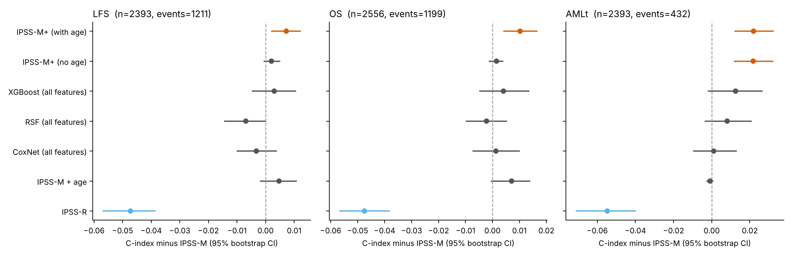
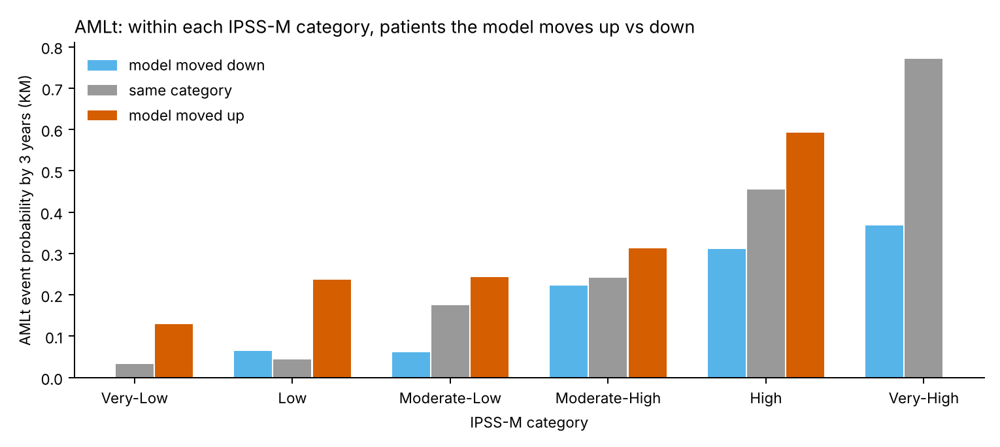

# IPSS-M+ : building on IPSS-M with the IPSS-M cohort

**Question.** Can a model trained on the IPSS-M cohort (cBioPortal `mds_iwg_2022`; Bernard et al., *NEJM Evidence* 2022;
3,323 treatment-naive MDS patients) predict outcomes better than IPSS-M, and when it disagrees with IPSS-M, is it right?

**Answer (internal cross-validation, this cohort only):**

| Endpoint | IPSS-M | Best new model | ΔC vs fair comparator (95% CI) | Verdict |
|---|---|---|---|---|
| Leukemia-free survival (IPSS-M's own endpoint) | 0.751 | IPSS-M+ (no age) 0.753 | +0.002 (−0.001 to +0.005) vs IPSS-M | not distinguishable |
| Overall survival | 0.749 | IPSS-M+ (with age) 0.760 | +0.003 (−0.000 to +0.007) vs IPSS-M + age | not distinguishable (age explains most of the gain) |
| **AML transformation** | 0.797 | **IPSS-M+ (no age) 0.819** | **+0.022 (+0.012 to +0.032) vs IPSS-M** | **better**, and better calibrated (IBS 0.104 vs 0.108) |

* For **LFS and OS, IPSS-M is at the ceiling** of what these 102 features carry. Elastic-net Cox, random survival
  forests and XGBoost built from scratch all match it but do not beat it, even with 148 genes, allele fractions and
  copy-number events. This agrees with a 2025 report that gene-interaction terms from the MDS molecular taxonomy did
  not improve IPSS-M.
* For **AML transformation, IPSS-M+ is better.** IPSS-M was fitted to leukemia-free survival, an endpoint that mixes
  transformation with death, and most events in that endpoint are deaths. Boosting from IPSS-M toward the transformation
  endpoint re-weights the inputs: less weight on anemia (which predicts death more than leukemia), more on marrow blasts,
  neutropenia, monocyte counts and clone size (U2AF1, DNMT3A allele fractions), and less risk for large SF3B1 clones.
  In a Cox model containing both scores, IPSS-M+ absorbs IPSS-M entirely (HR 2.92 per SD, p < 10⁻¹⁸; IPSS-M HR 1.10, p = 0.41).
* **The disagreements are real, on every endpoint.** Within each IPSS-M category, patients IPSS-M+ moves up do worse
  and those it moves down do better (stratified Cox, out-of-fold):

| Endpoint | Patients reclassified | HR, moved up vs same | HR, moved down vs same |
|---|---|---|---|
| LFS | 420 / 2,393 (18%) | 1.33 (1.07–1.64) | 0.66 (0.54–0.82) |
| OS | 942 / 2,556 (37%) | 2.01 (1.70–2.37) | 0.60 (0.51–0.71) |
| AML transformation | 961 / 2,393 (40%) | 1.88 (1.45–2.45) | 0.54 (0.40–0.72) |




Full tables: [`study_results/REPORT.md`](study_results/REPORT.md).

## What was already done, and what is new here

* **IPSS-M** (Bernard 2022): a Cox model with 31 genes, fitted on this cohort and validated in 754 Japanese patients.
* **Machine-learning MDS models**: random survival forests from Nazha et al. (*JCO* 2021, geno-clinical model) and the
  Spanish MDS group (AIPSS-MDS, clinical-only; a molecular follow-up). These were compared with IPSS-R or IPSS-M in
  other cohorts, so their C-indices are not directly comparable to this one.
* **New here:**
  1. **Boosting from IPSS-M** ("IPSS-M+"). IPSS-M's published score is a fixed starting point (offset), and
     gradient-boosted trees learn only corrections. That keeps IPSS-M's validated structure and lets the data add
     what IPSS-M leaves out.
  2. **A head-to-head on IPSS-M's own derivation data**, with IPSS-M given its in-sample advantage (it was fitted on these
     patients; every other model is scored out-of-sample).
  3. **AML transformation modelled separately** from death without transformation.
  4. **A reclassification test that checks whether disagreements are correct**, not just how many patients move.

## Design (fixed before results)

* **Patients:** those with an IPSS-M and IPSS-R score and the endpoint (LFS n = 2,393; OS n = 2,556; AML transformation
  n = 2,393 with 432 events).
* **Endpoints:**
  - LFS = transformation or death (IPSS-M's primary endpoint).
  - OS.
  - AML transformation = an LFS event not coinciding with death, with deaths censored (cause-specific).
* **Features (102):**
  - Clinical: age, sex, haemoglobin, platelets, ANC, WBC, monocytes, bone-marrow and peripheral blasts, therapy-related MDS.
  - Cytogenetics: IPSS-R cytogenetic risk, complex karyotype, and copy-number arm losses, gains and UPD from sequencing.
  - Mutations: driver status for 45 genes mutated in ≥1% of patients, maximum allele fraction for 15 common genes,
    mutation counts, FLT3-ITD, MLL-PTD, and TP53 multi-hit state.
* **Models:**
  - IPSS-R, IPSS-M (published scores), IPSS-M + age (Cox).
  - Elastic-net Cox, random survival forest and XGBoost on all features.
  - IPSS-M+ with and without age.
* **Validation:** 3× repeated 5-fold CV. Hyper-parameters are tuned by inner CV inside training folds, and survival
  probabilities are calibrated on inner out-of-fold predictions.
* **Metrics:** Harrell's and Uno's C-index, time-dependent AUC at 1/3/5 years, and integrated Brier score (6–60 months).
* **Statistics:** 1,000-sample patient bootstrap of paired C-index differences.
* **Rule:** "better" only if the 95% CI of the C-index difference is above 0. The primary comparisons are IPSS-M+ (no age)
  vs IPSS-M for LFS and AML transformation, and IPSS-M+ (with age) vs IPSS-M + age for OS.

## Limits (important before any claim)

* **No external validation.** cBioPortal has no second MDS cohort with outcomes (`mds_mskcc_2020` has mutations only).
  Every number here is internal cross-validation on one cohort. The AML-transformation result needs replication, e.g. in
  the Japanese IPSS-M validation cohort or another molecularly profiled cohort.
* **The AML-transformation endpoint is derived** from the LFS and OS times, because the study does not ship a separate
  transformation date. Deaths are treated as censoring (cause-specific). A competing-risk analysis (cumulative incidence,
  Fine–Gray) is the next step.
* **Treatment is not modelled.** Outcomes are as deposited; transplant and hypomethylating-agent effects are not
  accounted for.
* **IPSS-M+ needs the IPSS-M score as input** (from the official calculator), since it builds on it.

## Run it

```bash
pip install -r requirements.txt
python scripts/run_study.py --data data --out results      # downloads from cBioPortal; ~16 min on 4 CPU cores
```

## Use the trained models
```python
from mdsrisk.predict import load, score
m = load("study_results/models/AMLt_ipssm_plus.pkl")      # or LFS_ / OS_
out = score(m, clinical_df, mutations_df)                 # -> risk, category (IPSS-M-sized groups), ipssm_score
```
`clinical_df` uses the cBioPortal column names (AGE, SEX, HB, PLT, ANC, WBC, MONOCYTES, BM_BLAST, PB_BLAST, MDS_TYPE,
CYTO_IPSSR, COMPLEX_KARYOTYPE, CNACS_CHRARM_LOSS/GAIN/UPD, CHR_TP53_LOCUS, FLT3_ITD, MLL_PTD, IPSSM_SCORE, sampleId,
MUTATION_COUNT). `mutations_df` has one row per oncogenic mutation: sampleId, gene, vaf. Missing clinical values are
imputed. The scoring API reproduces the training pipeline exactly (checked on 40 patients per endpoint).
These are research models, not validated for clinical use.

## Layout
```
mdsrisk/data.py       cBioPortal download (cached) + outcome derivation
mdsrisk/features.py   102 features (clinical, cytogenetic, CN arms, mutations, VAFs, TP53 state)
mdsrisk/models.py     IPSS-M/IPSS-R scores, Cox, CoxNet, RSF, XGBoost, IPSS-M+ (boosting from the IPSS-M offset)
mdsrisk/evaluate.py   repeated CV, calibration, metrics, paired bootstrap, reclassification
mdsrisk/predict.py    score new patients with a saved model
scripts/run_study.py  the whole study -> REPORT.md, CSVs, figures, models
study_results/        outputs of the run reported above
```
