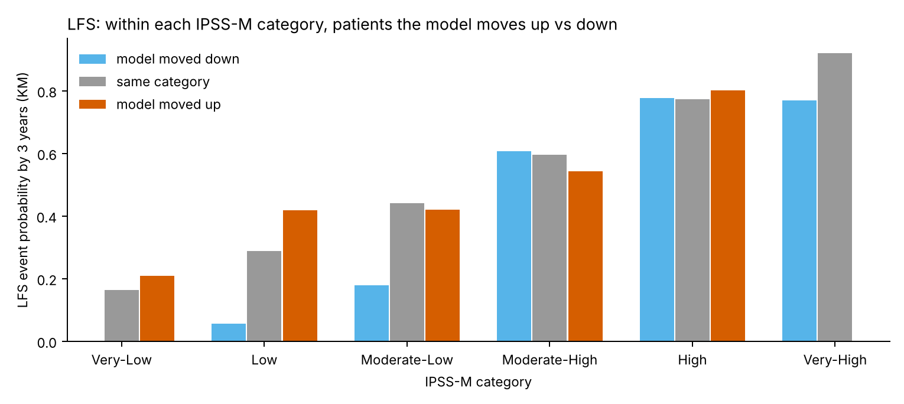
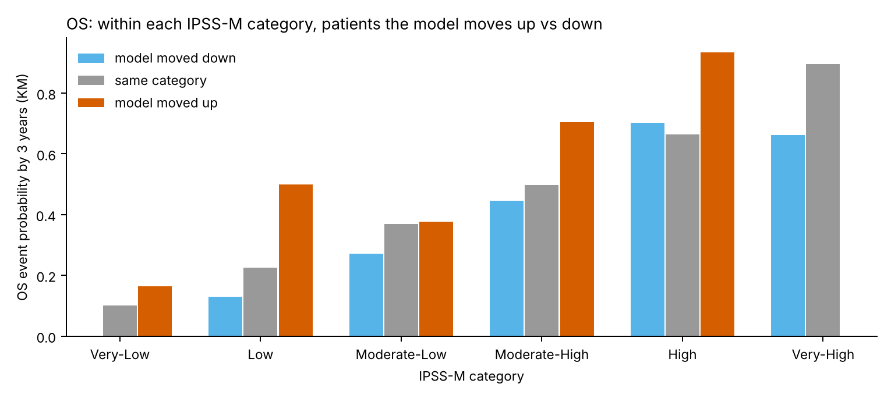
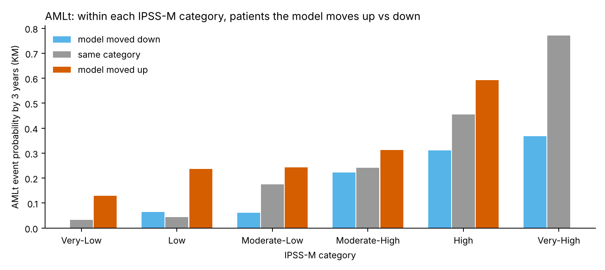
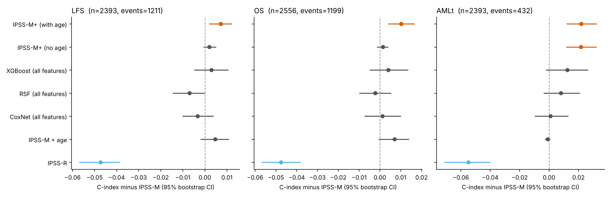
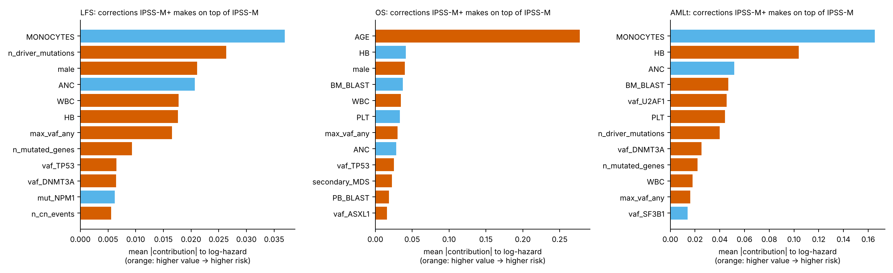

# Can a model trained on the IPSS-M cohort beat IPSS-M?

Data: cBioPortal `mds_iwg_2022` (IWG-PM; Bernard et al., NEJM Evidence 2022). 3x repeated 5-fold cross-validation; 95% CIs from 1000 patient bootstrap resamples of the out-of-fold predictions (repeat 0). Runtime 16 min.

IPSS-M's coefficients were fitted on these same patients, so it is evaluated **in-sample** while every other model is evaluated **out-of-sample**: any gain shown here is conservative.

**Pre-specified rule:** a model is better than its comparator only if the 95% CI of the C-index difference lies above 0. Primary comparisons: LFS and AMLt, IPSS-M+ (no age) vs IPSS-M; OS, IPSS-M+ (with age) vs IPSS-M + age.

## LFS (n = 2393, events = 1211)

**Primary: IPSS-M+ (no age) vs IPSS-M: ΔC = +0.002 (95% CI -0.001 to +0.005) → NOT DISTINGUISHABLE**

| model                  |   harrell_c |   c_lo |   c_hi |   uno_c_5y |   auc_12m |   auc_36m |   auc_60m |   ibs_6_60m |   dC_vs_IPSS-M |   dC_lo_vs_IPSS-M |   dC_hi_vs_IPSS-M |
|:-----------------------|------------:|-------:|-------:|-----------:|----------:|----------:|----------:|------------:|---------------:|------------------:|------------------:|
| IPSS-R                 |       0.704 |  0.689 |  0.719 |      0.685 |     0.741 |     0.752 |     0.725 |       0.186 |         -0.047 |            -0.057 |            -0.038 |
| IPSS-M                 |       0.751 |  0.737 |  0.766 |      0.739 |     0.794 |     0.813 |     0.813 |       0.165 |          0     |             0     |             0     |
| IPSS-M + age           |       0.756 |  0.742 |  0.77  |      0.749 |     0.791 |     0.824 |     0.852 |       0.159 |          0.005 |            -0.002 |             0.011 |
| CoxNet (all features)  |       0.748 |  0.733 |  0.762 |      0.741 |     0.782 |     0.815 |     0.836 |       0.165 |         -0.003 |            -0.01  |             0.004 |
| RSF (all features)     |       0.743 |  0.73  |  0.758 |      0.734 |     0.783 |     0.812 |     0.816 |       0.188 |         -0.007 |            -0.015 |             0     |
| XGBoost (all features) |       0.753 |  0.739 |  0.768 |      0.745 |     0.792 |     0.819 |     0.837 |       0.163 |          0.003 |            -0.005 |             0.011 |
| IPSS-M+ (no age)       |       0.753 |  0.739 |  0.768 |      0.741 |     0.797 |     0.814 |     0.814 |       0.164 |          0.002 |            -0.001 |             0.005 |
| IPSS-M+ (with age)     |       0.759 |  0.745 |  0.773 |      0.75  |     0.8   |     0.826 |     0.841 |       0.16  |          0.007 |             0.002 |             0.012 |

Lower integrated Brier score (ibs) = better calibrated survival probabilities.

### Reclassification by IPSS-M+ (no age) (420 of 2393 patients change IPSS-M category)

Hazard ratios WITHIN IPSS-M categories (stratified Cox): do patients the model moves up do worse, and those it moves down do better?

| covariate          |   exp(coef) |   exp(coef) lower 95% |   exp(coef) upper 95% |     p |
|:-------------------|------------:|----------------------:|----------------------:|------:|
| moved up vs same   |       1.326 |                 1.074 |                 1.636 | 0.009 |
| moved down vs same |       0.664 |                 0.538 |                 0.82  | 0     |

Both scores in one Cox model (standardised): does the new score add information beyond IPSS-M?

| covariate   |   exp(coef) |   exp(coef) lower 95% |   exp(coef) upper 95% |     p |
|:------------|------------:|----------------------:|----------------------:|------:|
| ipssm       |       1.478 |                 1.106 |                 1.974 | 0.008 |
| new         |       1.658 |                 1.245 |                 2.209 | 0.001 |

| ipssm         | direction   |   n |   events |   lfs_3y |   lfs_5y |
|:--------------|:------------|----:|---------:|---------:|---------:|
| Very-Low      | same        | 265 |       53 |    0.837 |    0.76  |
| Very-Low      | up          |  50 |       14 |    0.79  |    0.656 |
| Low           | down        |  50 |        9 |    0.945 |    0.897 |
| Low           | same        | 668 |      244 |    0.712 |    0.562 |
| Low           | up          |  56 |       26 |    0.581 |    0.429 |
| Moderate-Low  | down        |  56 |       16 |    0.822 |    0.544 |
| Moderate-Low  | same        | 183 |       81 |    0.558 |    0.421 |
| Moderate-Low  | up          |  34 |       18 |    0.58  |    0.243 |
| Moderate-High | down        |  36 |       23 |    0.392 |    0     |
| Moderate-High | same        | 182 |      117 |    0.404 |    0.25  |
| Moderate-High | up          |  35 |       22 |    0.456 |    0.228 |
| High          | down        |  38 |       27 |    0.223 |    0.062 |
| High          | same        | 276 |      191 |    0.226 |    0.097 |
| High          | up          |  31 |       22 |    0.199 |    0.132 |
| Very-High     | down        |  34 |       23 |    0.23  |    0.173 |
| Very-High     | same        | 399 |      325 |    0.079 |    0.033 |

## OS (n = 2556, events = 1199)

**Primary: IPSS-M+ (with age) vs IPSS-M + age: ΔC = +0.003 (95% CI -0.000 to +0.007) → NOT DISTINGUISHABLE**

| model                  |   harrell_c |   c_lo |   c_hi |   uno_c_5y |   auc_12m |   auc_36m |   auc_60m |   ibs_6_60m |   dC_vs_IPSS-M |   dC_lo_vs_IPSS-M |   dC_hi_vs_IPSS-M |
|:-----------------------|------------:|-------:|-------:|-----------:|----------:|----------:|----------:|------------:|---------------:|------------------:|------------------:|
| IPSS-R                 |       0.701 |  0.685 |  0.718 |      0.683 |     0.737 |     0.751 |     0.726 |       0.18  |         -0.047 |            -0.057 |            -0.038 |
| IPSS-M                 |       0.749 |  0.735 |  0.763 |      0.736 |     0.786 |     0.806 |     0.807 |       0.161 |          0     |             0     |             0     |
| IPSS-M + age           |       0.756 |  0.742 |  0.769 |      0.748 |     0.79  |     0.815 |     0.848 |       0.155 |          0.007 |            -0.001 |             0.014 |
| CoxNet (all features)  |       0.751 |  0.736 |  0.764 |      0.743 |     0.784 |     0.808 |     0.838 |       0.159 |          0.001 |            -0.007 |             0.01  |
| RSF (all features)     |       0.745 |  0.732 |  0.761 |      0.734 |     0.781 |     0.805 |     0.81  |       0.182 |         -0.002 |            -0.01  |             0.005 |
| XGBoost (all features) |       0.752 |  0.738 |  0.767 |      0.744 |     0.789 |     0.809 |     0.834 |       0.158 |          0.004 |            -0.005 |             0.014 |
| IPSS-M+ (no age)       |       0.75  |  0.736 |  0.764 |      0.737 |     0.788 |     0.805 |     0.806 |       0.161 |          0.002 |            -0.001 |             0.004 |
| IPSS-M+ (with age)     |       0.76  |  0.746 |  0.772 |      0.75  |     0.797 |     0.819 |     0.842 |       0.154 |          0.01  |             0.004 |             0.017 |

Lower integrated Brier score (ibs) = better calibrated survival probabilities.

### Reclassification by IPSS-M+ (with age) (942 of 2556 patients change IPSS-M category)

Hazard ratios WITHIN IPSS-M categories (stratified Cox): do patients the model moves up do worse, and those it moves down do better?

| covariate          |   exp(coef) |   exp(coef) lower 95% |   exp(coef) upper 95% |   p |
|:-------------------|------------:|----------------------:|----------------------:|----:|
| moved up vs same   |       2.009 |                 1.701 |                 2.372 |   0 |
| moved down vs same |       0.6   |                 0.51  |                 0.705 |   0 |

Both scores in one Cox model (standardised): does the new score add information beyond IPSS-M?

| covariate   |   exp(coef) |   exp(coef) lower 95% |   exp(coef) upper 95% |     p |
|:------------|------------:|----------------------:|----------------------:|------:|
| ipssm       |       0.896 |                 0.757 |                 1.062 | 0.205 |
| new         |       2.943 |                 2.469 |                 3.507 | 0     |

| ipssm         | direction   |   n |   events |   lfs_3y |   lfs_5y |
|:--------------|:------------|----:|---------:|---------:|---------:|
| Very-Low      | same        | 218 |       34 |    0.898 |    0.832 |
| Very-Low      | up          | 125 |       32 |    0.835 |    0.614 |
| Low           | down        | 125 |       22 |    0.871 |    0.855 |
| Low           | same        | 579 |      194 |    0.775 |    0.596 |
| Low           | up          | 134 |       63 |    0.5   |    0.282 |
| Moderate-Low  | down        |  92 |       25 |    0.729 |    0.648 |
| Moderate-Low  | same        | 107 |       48 |    0.631 |    0.406 |
| Moderate-Low  | up          |  94 |       43 |    0.624 |    0.198 |
| Moderate-High | down        |  99 |       54 |    0.553 |    0.369 |
| Moderate-High | same        | 103 |       58 |    0.503 |    0.272 |
| Moderate-High | up          |  70 |       44 |    0.296 |    0.092 |
| High          | down        |  83 |       54 |    0.298 |    0.214 |
| High          | same        | 218 |      142 |    0.337 |    0.108 |
| High          | up          |  57 |       41 |    0.066 |    0     |
| Very-High     | down        |  63 |       42 |    0.338 |    0.236 |
| Very-High     | same        | 389 |      303 |    0.105 |    0.04  |

## AMLt (n = 2393, events = 432)

**Primary: IPSS-M+ (no age) vs IPSS-M: ΔC = +0.022 (95% CI +0.012 to +0.032) → BETTER**

| model                  |   harrell_c |   c_lo |   c_hi |   uno_c_5y |   auc_12m |   auc_36m |   auc_60m |   ibs_6_60m |   dC_vs_IPSS-M |   dC_lo_vs_IPSS-M |   dC_hi_vs_IPSS-M |
|:-----------------------|------------:|-------:|-------:|-----------:|----------:|----------:|----------:|------------:|---------------:|------------------:|------------------:|
| IPSS-R                 |       0.742 |  0.718 |  0.765 |      0.713 |     0.767 |     0.78  |     0.768 |       0.127 |         -0.055 |            -0.071 |            -0.04  |
| IPSS-M                 |       0.797 |  0.777 |  0.817 |      0.781 |     0.833 |     0.846 |     0.86  |       0.108 |          0     |             0     |             0     |
| IPSS-M + age           |       0.796 |  0.777 |  0.817 |      0.782 |     0.831 |     0.848 |     0.865 |       0.107 |         -0.001 |            -0.003 |             0.001 |
| CoxNet (all features)  |       0.798 |  0.779 |  0.819 |      0.791 |     0.829 |     0.845 |     0.86  |       0.114 |          0.001 |            -0.01  |             0.013 |
| RSF (all features)     |       0.804 |  0.788 |  0.825 |      0.804 |     0.832 |     0.866 |     0.88  |       0.114 |          0.008 |            -0.004 |             0.021 |
| XGBoost (all features) |       0.809 |  0.79  |  0.828 |      0.801 |     0.84  |     0.861 |     0.869 |       0.109 |          0.013 |            -0.002 |             0.027 |
| IPSS-M+ (no age)       |       0.819 |  0.8   |  0.837 |      0.807 |     0.853 |     0.87  |     0.877 |       0.104 |          0.022 |             0.012 |             0.032 |
| IPSS-M+ (with age)     |       0.817 |  0.8   |  0.837 |      0.808 |     0.851 |     0.869 |     0.879 |       0.104 |          0.022 |             0.012 |             0.033 |

Lower integrated Brier score (ibs) = better calibrated survival probabilities.

### Reclassification by IPSS-M+ (no age) (961 of 2393 patients change IPSS-M category)

Hazard ratios WITHIN IPSS-M categories (stratified Cox): do patients the model moves up do worse, and those it moves down do better?

| covariate          |   exp(coef) |   exp(coef) lower 95% |   exp(coef) upper 95% |   p |
|:-------------------|------------:|----------------------:|----------------------:|----:|
| moved up vs same   |       1.882 |                 1.445 |                 2.453 |   0 |
| moved down vs same |       0.536 |                 0.402 |                 0.715 |   0 |

Both scores in one Cox model (standardised): does the new score add information beyond IPSS-M?

| covariate   |   exp(coef) |   exp(coef) lower 95% |   exp(coef) upper 95% |     p |
|:------------|------------:|----------------------:|----------------------:|------:|
| ipssm       |       1.105 |                 0.871 |                 1.401 | 0.412 |
| new         |       2.917 |                 2.299 |                 3.702 | 0     |

| ipssm         | direction   |   n |   events |   lfs_3y |   lfs_5y |
|:--------------|:------------|----:|---------:|---------:|---------:|
| Very-Low      | same        | 198 |        4 |    0.967 |    0.967 |
| Very-Low      | up          | 117 |       10 |    0.87  |    0.87  |
| Low           | down        | 109 |        4 |    0.936 |    0.936 |
| Low           | same        | 525 |       31 |    0.955 |    0.912 |
| Low           | up          | 140 |       27 |    0.764 |    0.705 |
| Moderate-Low  | down        | 118 |        6 |    0.939 |    0.939 |
| Moderate-Low  | same        |  88 |       13 |    0.824 |    0.789 |
| Moderate-Low  | up          |  67 |       14 |    0.757 |    0.757 |
| Moderate-High | down        |  99 |       15 |    0.778 |    0.729 |
| Moderate-High | same        |  81 |       14 |    0.759 |    0.701 |
| Moderate-High | up          |  73 |       20 |    0.687 |    0.634 |
| High          | down        | 106 |       18 |    0.69  |    0.632 |
| High          | same        | 177 |       57 |    0.545 |    0.31  |
| High          | up          |  62 |       26 |    0.408 |    0.272 |
| Very-High     | down        |  70 |       17 |    0.633 |    0.633 |
| Very-High     | same        | 363 |      156 |    0.229 |    0.137 |

## What IPSS-M+ corrects (final models, mean |TreeSHAP| contribution on top of IPSS-M)

### LFS

|                    |   mean_abs_contribution |   corr_value_vs_contribution |
|:-------------------|------------------------:|-----------------------------:|
| MONOCYTES          |                  0.0369 |                      -0.088  |
| n_driver_mutations |                  0.0264 |                       0.6207 |
| male               |                  0.0211 |                       0.9598 |
| ANC                |                  0.0207 |                      -0.1159 |
| WBC                |                  0.0177 |                       0.4086 |
| HB                 |                  0.0176 |                       0.3994 |
| max_vaf_any        |                  0.0166 |                       0.743  |
| n_mutated_genes    |                  0.0093 |                       0.6832 |
| vaf_TP53           |                  0.0065 |                       0.8599 |
| vaf_DNMT3A         |                  0.0064 |                       0.8283 |
| mut_NPM1           |                  0.0062 |                      -0.5365 |
| n_cn_events        |                  0.0055 |                       0.7951 |
| BM_BLAST           |                  0.0045 |                      -0.8176 |
| vaf_U2AF1          |                  0.0043 |                       0.8547 |
| secondary_MDS      |                  0.0039 |                       0.7166 |
| PLT                |                  0.0031 |                       0.0287 |
| vaf_SF3B1          |                  0.0029 |                      -0.524  |
| vaf_STAG2          |                  0.0024 |                      -0.3884 |
| mut_JAK2           |                  0.0024 |                       0.9981 |
| vaf_RUNX1          |                  0.0018 |                       0.4432 |

### OS

|                    |   mean_abs_contribution |   corr_value_vs_contribution |
|:-------------------|------------------------:|-----------------------------:|
| AGE                |                  0.2772 |                       0.9464 |
| HB                 |                  0.0413 |                      -0.8111 |
| male               |                  0.0402 |                       0.9441 |
| BM_BLAST           |                  0.0373 |                      -0.8871 |
| WBC                |                  0.0348 |                       0.0822 |
| PLT                |                  0.0335 |                      -0.4172 |
| max_vaf_any        |                  0.0301 |                       0.7788 |
| ANC                |                  0.0286 |                      -0.0632 |
| vaf_TP53           |                  0.0253 |                       0.9104 |
| secondary_MDS      |                  0.0223 |                       0.7649 |
| PB_BLAST           |                  0.0186 |                       0.7085 |
| vaf_ASXL1          |                  0.016  |                       0.7769 |
| MONOCYTES          |                  0.0151 |                       0.0953 |
| cyto_ipssr         |                  0.0122 |                       0.6125 |
| n_mutated_genes    |                  0.0118 |                       0.7209 |
| vaf_IDH2           |                  0.0088 |                      -0.5075 |
| n_driver_mutations |                  0.0085 |                       0.5059 |
| vaf_TET2           |                  0.0065 |                       0.6977 |
| gain8              |                  0.0051 |                       0.9988 |
| vaf_RUNX1          |                  0.0048 |                      -0.1922 |

### AMLt

|                    |   mean_abs_contribution |   corr_value_vs_contribution |
|:-------------------|------------------------:|-----------------------------:|
| MONOCYTES          |                  0.1653 |                      -0.215  |
| HB                 |                  0.1039 |                       0.8787 |
| ANC                |                  0.0516 |                      -0.847  |
| BM_BLAST           |                  0.0469 |                       0.9292 |
| vaf_U2AF1          |                  0.0456 |                       0.8982 |
| PLT                |                  0.0441 |                       0.8066 |
| n_driver_mutations |                  0.0399 |                       0.5709 |
| vaf_DNMT3A         |                  0.0253 |                       0.8493 |
| n_mutated_genes    |                  0.022  |                       0.7739 |
| WBC                |                  0.018  |                       0.5874 |
| max_vaf_any        |                  0.0161 |                       0.3931 |
| vaf_SF3B1          |                  0.0141 |                      -0.8379 |
| PB_BLAST           |                  0.0111 |                       0.7162 |
| vaf_ASXL1          |                  0.011  |                       0.8073 |
| secondary_MDS      |                  0.0094 |                      -0.0633 |
| vaf_RUNX1          |                  0.0063 |                       0.71   |
| mut_DDX41          |                  0.0061 |                       0.9956 |
| vaf_TP53           |                  0.0059 |                       0.6785 |
| n_cn_events        |                  0.0035 |                       0.426  |
| MLL_PTD            |                  0.0031 |                       0.9798 |

